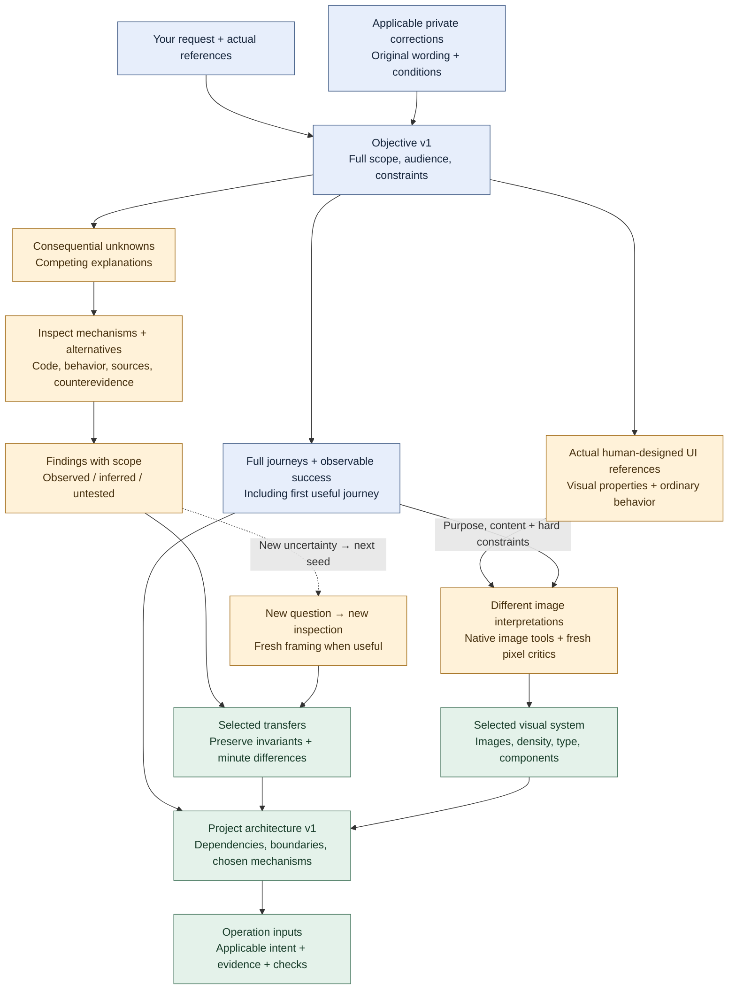
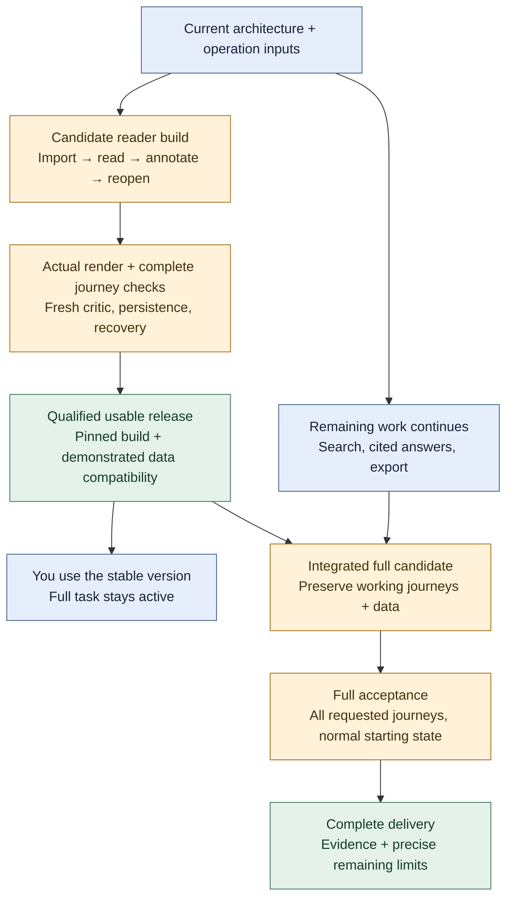
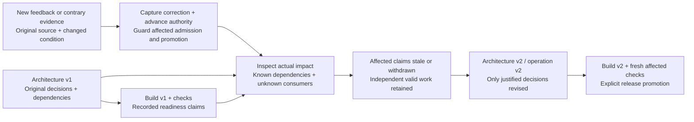

# A project through the factory

This illustrates the [proposed factory](factory-evolution.md), not a project run
that has already been demonstrated. The existing skill and helpers supply parts
of this path; the connective implementation and qualification remain pending.
These are moments in one illustrative journey, not mandatory stages. Research,
design and construction can overlap or loop; routine changes stay direct.

Imagine asking: “Build me a research reader. I want to import documents, annotate
them, search across them, ask questions with dependable source citations, and
export my work. Make it feel like these interfaces. Let me start using it while
you finish the rest.”

## Read the journey as a graph

These graphs show the intended states of that illustrative project, not live
status or an already qualified factory. A node represents a versioned input,
finding, decision, artifact or claim. An arrow means the next operation consumes
it. Parallel branches can proceed independently; a merge needs its actual
prerequisites. A node does not imply a separate service, worker or mandatory form.

### How the project architecture is created

The architecture is a result of interpreting the goal and transferring inspected
mechanisms. It is not a template chosen before investigating the problem.

Blue nodes carry intent and required outcomes. Amber nodes investigate or compare;
green nodes record a selection. Green means selected for use, not proven correct.
The real images and inspected evidence remain reachable from those selections.
Further research can branch from any consequential finding; each layer changes a
consumer or creates a genuinely new question. Routine work can reuse qualified
evidence rather than opening every branch.
Only applicable prerequisites gate an operation: independent behavior work does
not wait for visual selection when it can proceed without that decision.

### How construction becomes something you can use

The first useful release and full completion have different claims. Both depend
on real builds and checks; neither follows from a worker saying it finished.

Only successful, current, claim-specific checks can support the outgoing arrows
from a check node. Failed or uncertain results create a scoped investigation or
repair; they do not promote the candidate. A first usable release is nonterminal.
Stable and development versions need compatible shared data or actual isolation,
not merely different URLs. Parallelism follows coherent boundaries and available
integration capacity.

### How corrections change state without erasing history

A DAG can represent an iterative process by adding a new generation. It does not
send an arrow backward and pretend an old build consumed a later correction.

The active state is a projection of the latest valid records. Earlier sources,
decisions and failed checks stay available. Unknown impact broadens inspection;
it is not permission to keep a stale result. A usable build can remain available
only while its readiness evidence still applies. Interruption additionally
requires target-state reconciliation and immutable release/adapter identities;
stopping a worker alone does not settle its effects.
Authority advances before impact inspection and new work admission. Actual
target adapters must qualify that boundary; an append-only event cannot fence
effects on a target that does not enforce it. Unsupported stale-effect exclusion
remains an explicit limit.

## 1. Your request remains the entry point

You explain the outcome and supply references. The native agent identifies the
audience, normal starting state, full requested functions, visual preferences and
hard constraints. It briefly explains its interpretation. It resolves a
consequential ambiguity with evidence or a focused question; you do not need to
choose frameworks, schedule workers or fill out a factory form.

## 2. Relevant history informs this project

The agent retrieves applicable prior corrections with their original wording,
reasons and conditions. An explicit font instruction enters generation and code.
A complaint about one overcrowded screen does not become a rule to make every
screen sparse. Private history stays private. A new agent should not repeatedly
ask an already answered question unless the circumstances changed.

## 3. Full completion and first useful use are both defined

The complete destination still includes imports, annotations, search, cited
answers and export. The first useful journey could be: import a document, read
it, save an annotation, close the app and return to the saved work.

That journey needs functioning storage, navigation and recovery, not just a
finished reader screen. The agent identifies prerequisites and shared resources.
Independent work on search or answer generation can proceed alongside it.

## 4. References receive specific jobs

One shipped product might supply reader density; another might supply annotation
behavior. An OSS parser might supply an implementation mechanism. A mature chat
component might supply scroll and streaming behavior. The agent inspects actual
images, interactions and code rather than copying names or descriptions.

Minute differences and conditional alternatives remain recoverable. Compatible
mechanisms can share an implementation; unsuitable mechanisms remain available
with reasons and activation conditions. Code reuse preserves licenses. A requested
clean room instead separates source analysis from permitted behavioral exports
and enforces the builder's access boundary.

## 5. Images help discover the visual system

The agent gives the image model your actual references, representative content
and a concise purpose, with freedom to explore materially different compositions.
Early studies reveal a shared hierarchy, density, type and component language
before dozens of screens are implemented.

Codex uses native image tools. Claude delegates bounded image work through the
installed Codex CLI, including `codex --yolo` under the native authorized permission
policy, using actual image inputs and retrieving the outputs. The
concrete route is checked. Fresh critics inspect readable reference and candidate
pixels without being told which candidate should win. You see a concrete
comparison when an unresolved consequential taste choice needs your judgment.

The chosen system guides later screens. Geist is the default sans-serif; Inter
is prohibited. Hugeicons Free Stroke Rounded is the default icon family. Local
screen adaptations preserve the chosen character rather than inventing a new
design every time.

## 6. Research follows the next consequential uncertainty

Suppose citations look convincing but point at the wrong passage. The agent
investigates where document identity or page mapping was lost, compares relevant
solutions and tests a discriminating case before repeatedly patching the answer.
A finding about parsing can create a seed about provenance; that finding can
create a seed about evaluation. Surprising evidence can replace the original
explanation altogether.

Each loop produces a changed selection, experiment, prompt, builder input or
check. Fresh scoped handoffs can challenge inherited framing. Normal depth follows
uncertainty; an explicitly requested deep chain is honored. The architecture's
[research evidence](factory-design-evidence.md) contains 12-, 13- and 17-layer
dependent chains, not a requirement for that many searches on every task.

## 7. The agent builds with the evidence it actually needs

Each substantial producing operation receives the current applicable requirements,
selected reference properties, actual images or other materials, dependencies and
expected checks. Precise image-to-code work measures real fonts, control geometry,
wrapping and viewport scale. A file path or font name in a prompt does not establish
that the producer saw the image or the browser rendered that font.

Workers handle coherent independent work when delegation helps. The native agent
integrates their results and owns the full outcome. Shared changes are coordinated;
more workers are not automatically faster when integration is the bottleneck.

## 8. The real product is examined

Fresh visual review compares the original references, selected design and actual
coded renders. This catches both a bad interpretation and imperfect implementation.
Complete journey checks exercise real content, errors, empty states, persistence
and recovery. A plausible screenshot cannot establish that saving works.

Checks must detect realistic seeded failures before they can authorize their
intended class of result. Formal tools can help with precise invariants; they
cannot establish that a weak specification captured your intent or that the UI
feels right. An uncertain result stays uncertain.

The coordination rules initially extend existing typed records and helpers.
Compare an executable Lean model or a small custom language when recurring
semantic errors or multiple backends justify that work. The useful question is
whether it governs the actual decision better, not whether it makes the process
look more formal. Model choice, representation and runtime enforcement remain
separate decisions.

## 9. You receive a dependable version while construction continues

When the import/read/annotate/reopen journey works on a specific qualified build,
the agent shows or opens that version and explains its usable scope. You can use
it. Search, answers and export remain active obligations; early use is not final
completion.

Candidate changes run separately. Shared storage needs demonstrated compatibility
or isolation. A migration that would break your reader blocks promotion even if
the new search screen looks finished. Stable application versions alone do not
make mutable data safe.

## 10. Your correction changes the next operation

You say the annotation panel feels too spacious. The original feedback becomes
controlling evidence for the relevant design and builder decisions. The next
operation consumes it, and the new coded render is checked against it. Merely
adding a lesson document does not count as application.

Unaffected work is reused when inspected dependencies justify that decision.
A shared token, data contract or unknown consumer widens revalidation. If feedback
makes the stable version unacceptable, its affected readiness claim is withdrawn;
the factory does not continue calling it ready because yesterday's check passed.

## 11. Interruptions preserve useful work without inventing certainty

Resume uses the actual current objective, stable release, remaining work and
package/adapter identities. Completed valid evidence is retained. Pending external
effects are observed before retrying: a lost reply may hide a successful commit.
Stopping a worker is not proof that its effects stopped.

The native route is the baseline. A durable runtime is added for demonstrated
recovery needs; tracked incremental computation is added for suitable repeated
pure work. Neither requires replacing the conversation or its permission policy.

## 12. Completion covers the entire original destination

Final acceptance exercises imports, annotations, search, cited answers and export
from the normal entry and default state, with applicable visual and recovery
requirements. It includes omissions and limits honestly. The first usable journey
cannot substitute for that full obligation set.

The factory compares total completion time, fidelity, research/review/retry cost
and your supervision against the current approach. A faster image call or a larger
source list is not proof of a better whole project.

## 13. Useful findings improve later work

Preserve which reference property or research mechanism changed the producing
operation, its outcome, conditions and reopen trigger. Repeatedly useful general
mechanisms can improve the reusable skill after review and suitable qualification.
Private examples and history remain private. Weak or expensive optimizations can
be disabled without discarding the ideas behind them.

Distribute the reusable process as a portable skill with local helpers and optional
host/domain adapters. Qualify installation, actual invocation and evidence use in
each supported host. One successful project does not establish a reusable
integration, and an installed file does not establish that an agent applied it.

The intended experience is ordinary collaboration: you explain and react to
concrete work; the agent handles research, coordination, implementation and
verification. The machinery earns its place by improving the complete result
and reducing repeated supervision.
